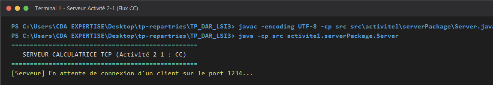
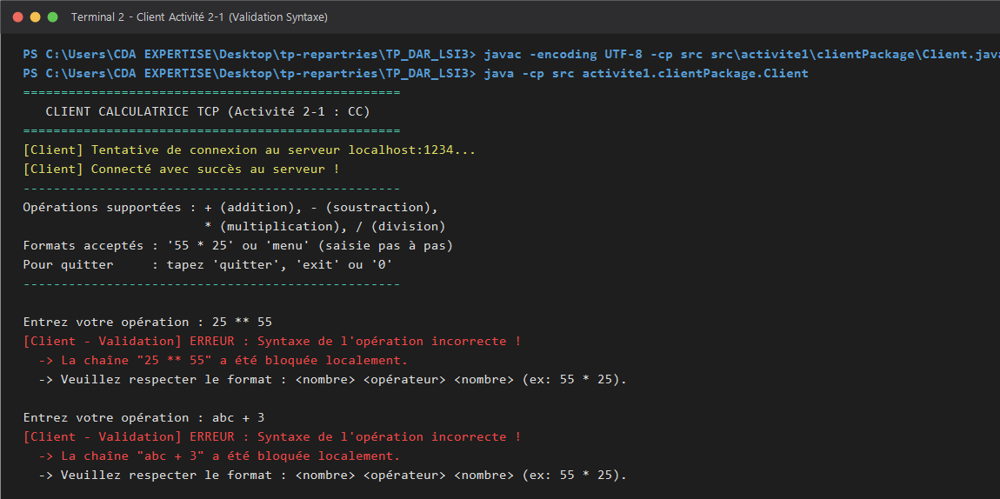
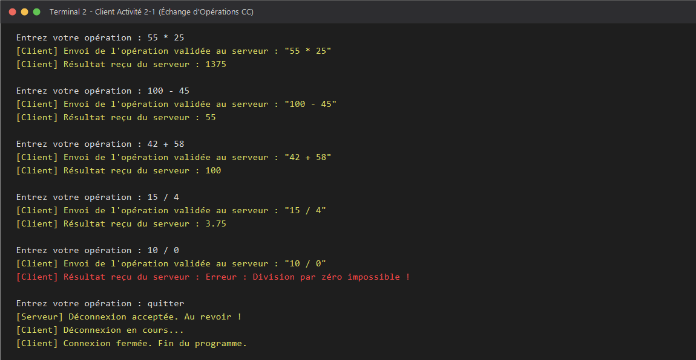
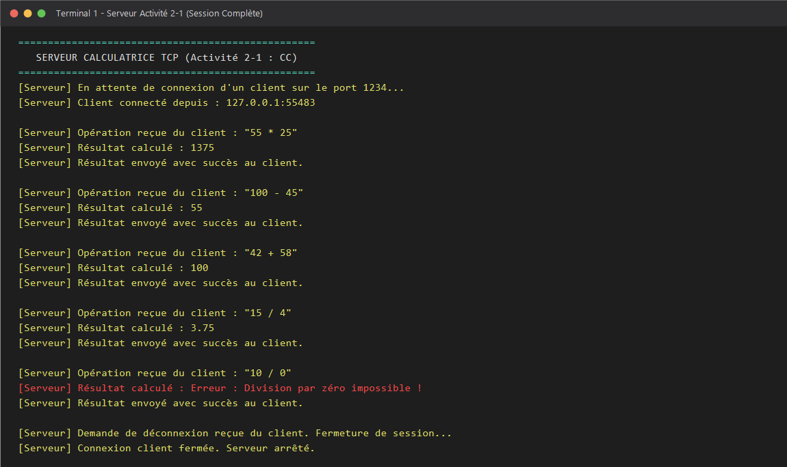
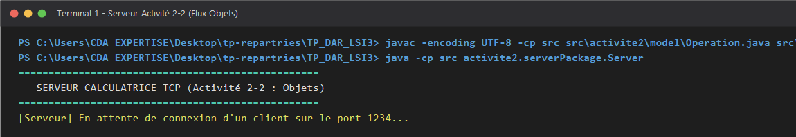
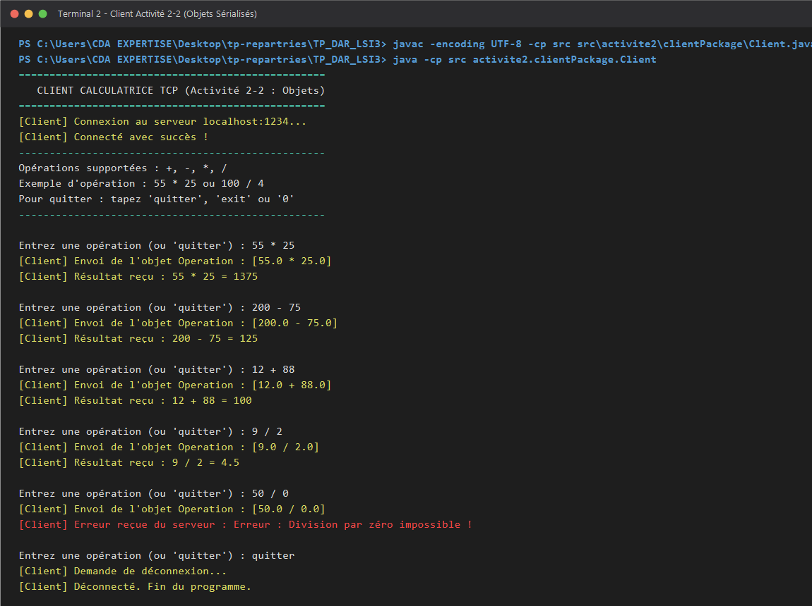
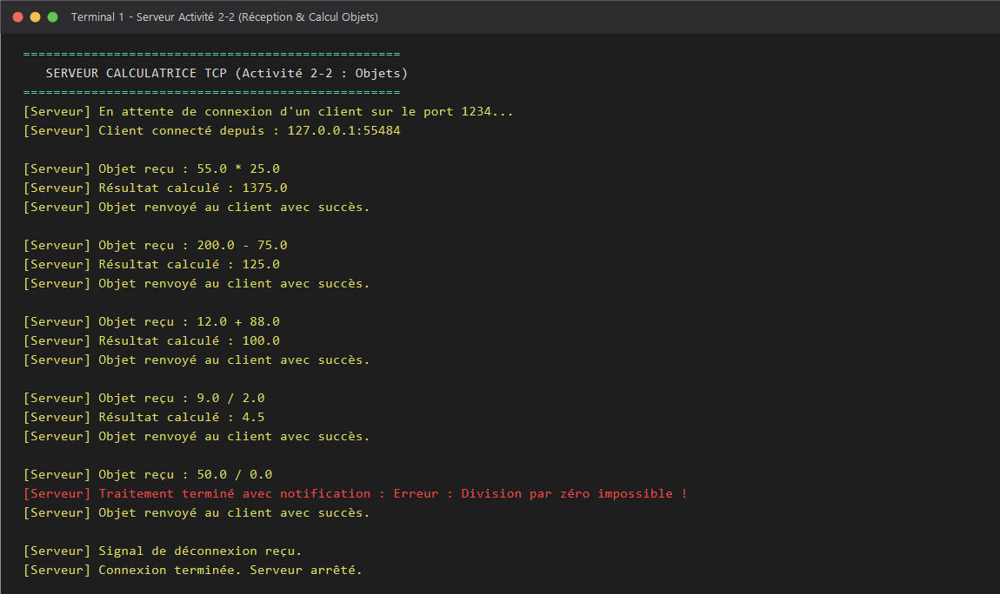

# TP 2 : Les sockets en mode connecté TCP : E/R de CC & objets

**Faculté des Sciences de Sfax — Département d'informatique et des Communications**  
**Auditoire :** LSI 3 — Année Universitaire 2026 – 2027  
**Matière :** Développement d’applications réparties  
**Responsables du cours :** Amal ABID & Corinne Amel ZAYANI | **Enseignante des TPs :** Amal ABID  
**Étudiant :** Salmen Zekri  

---

## Sommaire
- [Activité 2-1 : Échange de chaînes de caractères (CC) entre Client/Serveur via Sockets TCP](#activité-2-1--échange-de-chaînes-de-caractères-cc-entre-clientserveur-via-sockets-tcp)
  - [1. Objectifs & Contexte](#1-objectifs--contexte-activité-2-1)
  - [2. Architecture & Flux de traitement](#2-architecture--flux-de-traitement-activité-2-1)
  - [3. Étape 1 : Préparation de l'espace de travail](#3-étape-1--préparation-de-lespace-de-travail-activité-2-1)
  - [4. Étape 2 : Application des flux de traitement de CC](#4-étape-2--application-des-flux-de-traitement-de-cc)
  - [5. Résultats et Tableaux de tests](#5-résultats-et-tableaux-de-tests-activité-2-1)
- [Activité 2-2 : Échange des objets entre Client/Serveur via Sockets TCP](#activité-2-2--échange-des-objets-entre-clientserveur-via-sockets-tcp)
  - [1. Objectifs & Contexte](#1-objectifs--contexte-activité-2-2)
  - [2. La classe Serializable : `Operation.java`](#2-la-classe-serializable--operationjava)
  - [3. Architecture & Flux d'objets (`ObjectInputStream` / `ObjectOutputStream`)](#3-architecture--flux-dobjets)
  - [4. Déroulement étape par étape (a à g)](#4-déroulement-étape-par-étape-a-à-g)
  - [5. Résultats et Tableaux de tests](#5-résultats-et-tableaux-de-tests-activité-2-2)
- [Commandes de compilation et d'exécution](#commandes-de-compilation-et-dexécution)
- [Livrables & Dépôt GitHub](#livrables--dépôt-github)

---
---

# Activité 2-1 : Échange de chaînes de caractères (CC) entre Client/Serveur via Sockets TCP

### 1. Objectifs & Contexte (Activité 2-1)
Dans l'Activité 1-2 du TP N°01, les applications Client et Serveur étaient limitées à l'échange d'octets/entiers simples (`DataInputStream` / `DataOutputStream`). Cette limitation empêchait l'envoi d'opérations complètes formulées en langage naturel ou mathématique, comme `(34 * 55)`.

Les objectifs de cette activité sont :
- Maîtriser l'implémentation de l'envoi et de la réception (E/R) de chaînes de caractères (CC) entre un client et un serveur en mode connecté TCP.
- Exploiter les classes du package `java.io` pour la gestion des flux de caractères : `BufferedReader`, `InputStreamReader` et `PrintWriter`.
- Implémenter une **validation de syntaxe côté client** afin de rejeter localement toute expression incorrecte (ex : `25 ** 55` ou `abc + 3`) avant toute émission sur le réseau.
- Permettre au client d'envoyer une opération complète (ex: `55 * 25`), que le serveur calcule puis renvoie le résultat.

---

### 2. Architecture & Flux de traitement (Activité 2-1)

Pour manipuler des chaînes de caractères sur des sockets TCP en Java :
1. **Lecture de chaînes côté Serveur et Client :**  
   On encapsule le flux binaire de la socket dans un pont d'encodage `InputStreamReader`, puis dans un tampon de lecture `BufferedReader` :
   ```java
   BufferedReader in = new BufferedReader(new InputStreamReader(socket.getInputStream()));
   String message = in.readLine(); // Lit une ligne complète terminée par '\n'
   ```
2. **Écriture de chaînes côté Serveur et Client :**  
   On utilise la classe `PrintWriter` avec l'option `autoFlush = true` pour envoyer immédiatement chaque ligne formatée :
   ```java
   PrintWriter out = new PrintWriter(socket.getOutputStream(), true);
   out.println(reponse); // Envoie la chaîne suivie d'un saut de ligne
   ```

---

### 3. Étape 1 : Préparation de l'espace de travail (Activité 2-1)
Le projet est organisé sous une arborescence claire :
```text
TP_DAR_LSI3/
├── src/
│   └── activite1/
│       ├── clientPackage/
│       │   └── Client.java
│       └── serverPackage/
│           └── Server.java
├── captures/
│   ├── act2-1-serveur-en-attente.png
│   ├── act2-1-client-validation-erreurs.png
│   ├── act2-1-client-calculs.png
│   └── act2-1-serveur-session-complete.png
└── README.md
```

---

### 4. Étape 2 : Application des flux de traitement de CC

#### a) Validation syntaxique locale avant envoi (Côté Client)
L'énoncé stipule :
> *"Vous pouvez ajouter tous les types d'opérations (addition, soustraction, multiplication et division), et valider la syntaxe avant que le serveur ne reçoive l'opération envoyée par le client. Cette validation empêche l'envoi d'une chaîne incorrecte comme 25 \*\* 55 ou abc + 3."*

Nous avons implémenté cette vérification à l'aide d'une expression régulière stricte :
```java
private static final Pattern OPERATION_PATTERN = Pattern.compile(
    "^\\s*(-?\\d+(?:\\.\\d+)?)\\s*([+\\-*/])\\s*(-?\\d+(?:\\.\\d+)?)\\s*$"
);
```
Si l'utilisateur tape une expression non conforme :
- Le client détecte l'erreur immédiatement.
- Un message explicatif rouge est affiché.
- **Aucun paquet n'est transmis sur le réseau**, ce qui protège le serveur de requêtes malformées.

#### b) Traitement et calcul (Côté Serveur)
Le serveur lit la chaîne reçue, extrait le premier opérande, l'opérateur et le deuxième opérande, puis effectue le calcul selon l'opérateur :
- `+` : Addition
- `-` : Soustraction
- `*` : Multiplication
- `/` : Division (avec détection de division par zéro)

#### c) Envoi du résultat au client
Le serveur envoie le résultat calculé (ou le message d'erreur approprié) sous forme de chaîne de caractères via `out.println(reponse)`.

#### d) Lecture et affichage par le client
Le client lit la réponse avec `in.readLine()` et l'affiche à l'écran.

---

### 5. Résultats et Tableaux de tests (Activité 2-1)

#### Capture 1 : Lancement du serveur Activité 2-1 en attente


*Interprétation :*  
Le serveur démarre, instancie `ServerSocket(1234)`, et se met en attente passive d'une connexion cliente (`accept()`).

---

#### Capture 2 : Client Activité 2-1 — Validation syntaxique bloquante


*Interprétation :*  
Lors de la saisie de chaînes malformées telles que `25 ** 55` ou `abc + 3`, le validateur regex du client intercepte l'erreur en local. Aucun message n'est envoyé au serveur. L'utilisateur est invité à corriger sa saisie.

---

#### Capture 3 : Client Activité 2-1 — Session de calculs et déconnexion


*Interprétation :*  
Le client transmet des opérations valides (`55 * 25`, `100 - 45`, `42 + 58`, `15 / 4`), ainsi qu'une division par zéro (`10 / 0`). Chaque résultat est reçu en retour sous forme de chaîne de caractères. La commande `quitter` termine la session en conformité avec le protocole.

---

#### Capture 4 : Serveur Activité 2-1 — Session complète


*Interprétation :*  
Le serveur trace chaque requête reçue, affiche le calcul effectué, expédie la réponse correspondante, puis libère les ressources lors de la réception du signal de déconnexion.

#### Tableau récapitulatif des tests (Activité 2-1) :
| Saisie Client | Statut Validation | Envoyé au Serveur ? | Résultat Serveur | Affichage Client |
|:---:|:---:|:---:|:---:|:---:|
| `25 ** 55` | ❌ Rejeté (syntaxe) | **Non** | — | `ERREUR : Syntaxe incorrecte` |
| `abc + 3` | ❌ Rejeté (non numérique) | **Non** | — | `ERREUR : Syntaxe incorrecte` |
| `55 * 25` |  Valide | **Oui** | `1375` | `1375` |
| `100 - 45` |  Valide | **Oui** | `55` | `55` |
| `42 + 58` |  Valide | **Oui** | `100` | `100` |
| `15 / 4` |  Valide | **Oui** | `3.75` | `3.75` |
| `10 / 0` |  Valide | **Oui** | `Erreur : Division par zéro` | `Erreur : Division par zéro impossible !` |
| `quitter` |  Commande de fin | **Oui** | Arrêt session | `Connexion fermée. Fin du programme.` |

---
---

# Activité 2-2 : Échange des objets entre Client/Serveur via Sockets TCP

### 1. Objectifs & Contexte (Activité 2-2)
Dans cette seconde activité, nous passons de l'échange de chaînes brutes à **l'échange d'objets Java structurés et fortement typés**.

Les objectifs sont :
- Implémenter l'échange d'objets complets entre un client et un serveur en mode connecté TCP.
- Exploiter l'interface `java.io.Serializable` pour permettre la sérialisation / désérialisation binaire des objets.
- Utiliser les flux `ObjectOutputStream` et `ObjectInputStream`.
- Maîtriser les bonnes pratiques réseau liées aux flux d'objets (ordre d'initialisation des flux pour éviter les interblocages, utilisation de `reset()` pour éviter le cache d'objets).

---

### 2. La classe Serializable : `Operation.java`

Pour respecter l'exigence :
> *"a) Créez une classe Java qui implémente l'interface « Serializable »."*

Nous avons conçu la classe `activite2.model.Operation` :
```java
package activite2.model;

import java.io.Serializable;

public class Operation implements Serializable {
    private static final long serialVersionUID = 1L;

    private double op1;
    private double op2;
    private char operateur; // '+', '-', '*', '/'
    private double resultat;
    private boolean isErreur;
    private String messageErreur;

    public Operation(double op1, char operateur, double op2) {
        this.op1 = op1;
        this.operateur = operateur;
        this.op2 = op2;
        this.isErreur = false;
    }

    // Getters et Setters complets
    public double getOp1() { return op1; }
    public double getOp2() { return op2; }
    public char getOperateur() { return operateur; }
    public double getResultat() { return resultat; }
    public void setResultat(double resultat) { this.resultat = resultat; }
    public boolean isErreur() { return isErreur; }
    public String getMessageErreur() { return messageErreur; }
    public void setMessageErreur(String msg) { this.messageErreur = msg; this.isErreur = true; }
    
    @Override
    public String toString() {
        if (isErreur) return messageErreur;
        return op1 + " " + operateur + " " + op2 + " = " + resultat;
    }
}
```

---

### 3. Architecture & Flux d'objets

#### Règle essentielle : Ordre d'instanciation des flux d'objets
Lors de l'utilisation de `ObjectInputStream` et `ObjectOutputStream` sur des sockets TCP :
- Le constructeur de `ObjectInputStream` tente immédiatement de lire le **header de sérialisation** (nombre magique et version) émis par l'autre extrémité.
- Si les deux côtés instancient `new ObjectInputStream(...)` en premier, les deux processus attendent un header qui n'a jamais été émis, entraînant un **Deadlock (interblocage)** permanent.

**Solution appliquée rigoureusement :**
Toujours instancier `ObjectOutputStream` en premier, suivi d'un `flush()`, avant d'instancier `ObjectInputStream` :
```java
ObjectOutputStream oos = new ObjectOutputStream(socket.getOutputStream());
oos.flush(); // Émet immédiatement le header de sérialisation
ObjectInputStream ois = new ObjectInputStream(socket.getInputStream());
```

#### Éviter le cache de références avec `oos.reset()`
`ObjectOutputStream` mémorise les références des objets déjà émis afin d'optimiser les flux. Si un objet est modifié et renvoyé, le flux risque de réémettre la référence initiale au lieu de l'état mis à jour. L'appel à `oos.reset()` après chaque émission résout ce problème.

---

### 4. Déroulement étape par étape (a à g)

Le cycle de traitement respecte scrupuleusement les exigences du sujet :
- **Étape a :** Création de la classe `Operation implements Serializable`.
- **Étape b :** Le client instancie `new Operation(op1, operateur, op2)` et transmet l'objet au serveur via `oos.writeObject(operation)`.
- **Étape c :** Le serveur reçoit l'objet via `ois.readObject()`.
- **Étape d :** Le serveur extrait les données de l'objet via ses accesseurs (`op.getOp1()`, `op.getOperateur()`, `op.getOp2()`).
- **Étape e :** Le serveur effectue le calcul arithmétique demandé (`+`, `-`, `*`, `/`). En cas de division par zéro, il configure le message d'erreur.
- **Étape f :** Le serveur met à jour l'attribut `resultat` (ou `messageErreur`) dans l'objet, puis renvoie l'objet sérialisé au client via `oos.writeObject(op)`.
- **Étape g :** Le client lit l'objet reçu (`Operation resultatOp = (Operation) ois.readObject()`) et affiche le résultat final.

---

### 5. Résultats et Tableaux de tests (Activité 2-2)

#### Capture 5 : Serveur Activité 2-2 en attente


*Interprétation :*  
Le serveur d'objets initialise son écoute sur le port 1234 et attend la connexion d'un client.

---

#### Capture 6 : Client Activité 2-2 — Échange d'objets


*Interprétation :*  
Pour chaque opération saisie par l'utilisateur, le client instancie un objet `Operation`, le sérialise et le transmet via TCP. Il reçoit ensuite l'objet calculé en retour et affiche le résultat (`55 * 25 = 1375`, `200 - 75 = 125`, `12 + 88 = 100`, `9 / 2 = 4.5`, ainsi que l'interception de la division par zéro `50 / 0`).

---

#### Capture 7 : Serveur Activité 2-2 — Traitement et calcul des objets


*Interprétation :*  
Le serveur désérialise les objets reçus, extrait leurs propriétés, effectue les calculs, encapsule les résultats (ou erreurs) et réexpédie l'objet au client.

#### Tableau récapitulatif des tests (Activité 2-2) :
| Opération | Objet émis par Client | Données extraites par Serveur | Calcul Serveur | Objet retourné au Client | Affichage Client |
|:---:|:---:|:---:|:---:|:---:|:---:|
| `55 * 25` | `Operation(55, '*', 25)` | `op1=55, op='*', op2=25` | `55 * 25 = 1375.0` | `Operation(..., res=1375.0)` | `55 * 25 = 1375` |
| `200 - 75` | `Operation(200, '-', 75)` | `op1=200, op='-', op2=75` | `200 - 75 = 125.0` | `Operation(..., res=125.0)` | `200 - 75 = 125` |
| `12 + 88` | `Operation(12, '+', 88)` | `op1=12, op='+', op2=88` | `12 + 88 = 100.0` | `Operation(..., res=100.0)` | `12 + 88 = 100` |
| `9 / 2` | `Operation(9, '/', 2)` | `op1=9, op='/', op2=2` | `9 / 2 = 4.5` | `Operation(..., res=4.5)` | `9 / 2 = 4.5` |
| `50 / 0` | `Operation(50, '/', 0)` | `op1=50, op='/', op2=0` | `Division par zéro !` | `Operation(..., isErreur=true)` | `Erreur : Division par zéro impossible !` |
| `quitter` | `null` | Déconnexion détectée | Fermeture session | Fin de flux | `Déconnecté. Fin du programme.` |

---
---

## Commandes de compilation et d'exécution

### Activité 2-1 (Échange de Chaînes de Caractères)

**1. Compilation :**
```powershell
javac -encoding UTF-8 -cp src src\activite1\serverPackage\Server.java src\activite1\clientPackage\Client.java
```

**2. Lancement du Serveur (dans le 1er terminal) :**
```powershell
java -cp src activite1.serverPackage.Server
```

**3. Lancement du Client (dans le 2ème terminal) :**
```powershell
java -cp src activite1.clientPackage.Client
```

---

### Activité 2-2 (Échange d'Objets Sérialisables)

**1. Compilation :**
```powershell
javac -encoding UTF-8 -cp src src\activite2\model\Operation.java src\activite2\serverPackage\Server.java src\activite2\clientPackage\Client.java
```

**2. Lancement du Serveur (dans le 1er terminal) :**
```powershell
java -cp src activite2.serverPackage.Server
```

**3. Lancement du Client (dans le 2ème terminal) :**
```powershell
java -cp src activite2.clientPackage.Client
```

---
---

## Livrables & Dépôt GitHub

- **Lien du repository GitHub :**  
  [https://github.com/zikosalmen/SalmenZekri_LSI3_DevAppReparties_tp2.git](https://github.com/zikosalmen/SalmenZekri_LSI3_DevAppReparties_tp2.git)
- **Espace ENT :**  
  Le livrable est conforme aux exigences des deux énoncés (`TP2_Activité2-1` et `TP2_Activité2-2`).
